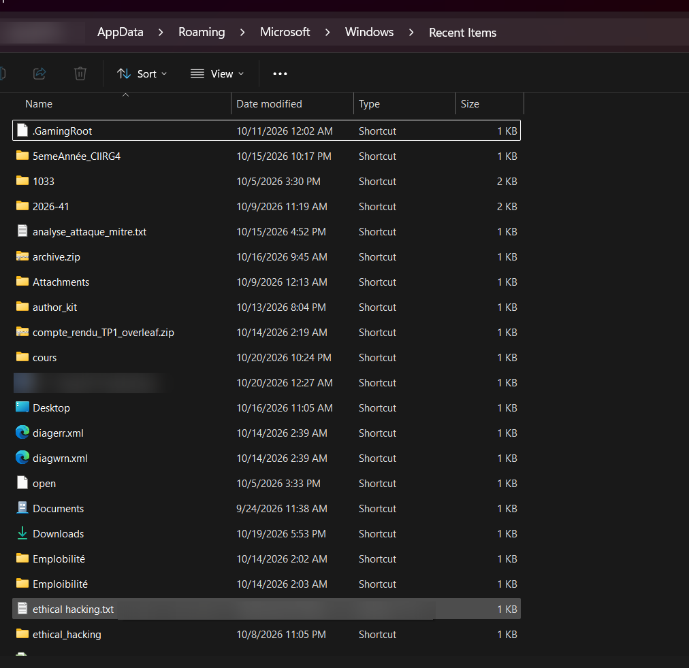
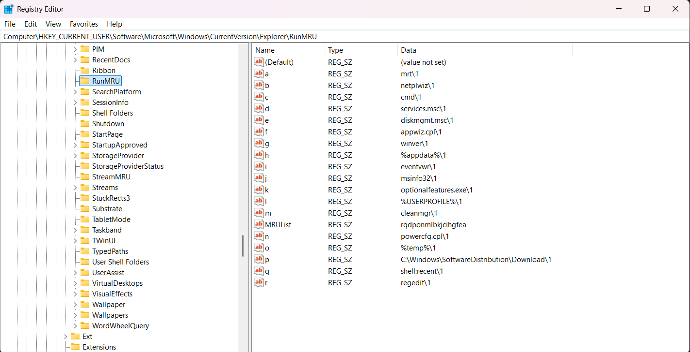
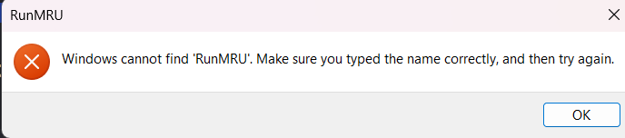
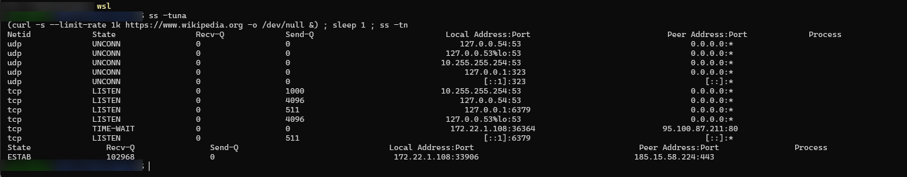

# TP  : Exploration des Artefacts et Volatilité Système


## Objectifs

1. Manipuler des artefacts volatils et persistants sur sa propre machine.
2. Expérimenter la hiérarchie de la **RFC 3227** (ordre de volatilité).
3. Transformer un indice technique brut en preuve légale.

### Rappel : ordre de volatilité (RFC 3227), du plus au moins volatil

| Niveau | Donnée |
|---|---|
| 1 | Registres du processeur, cache |
| 2 | Table de routage, cache ARP, table des processus, statistiques noyau, connexions réseau |
| 3 | Mémoire vive (RAM) |
| 4 | Fichiers temporaires / swap |
| 5 | Disque dur |
| 6 | Journaux distants, données de supervision |
| 7 | Configuration physique, topologie réseau |
| 8 | Supports d'archivage |

> Les sorties de commandes sont reproduites en texte dans les encadrés **« Ma preuve »**, et les captures d'écran sont dans le dossier `captures/`. Les informations personnelles (nom d'utilisateur, nom de machine, fin des adresses MAC) ont été masquées ou floutées avant publication.

---

# Partie 1 : Environnement Windows

## I. Environnement volatil

### Connexions réseau (Niveau 2) : `netstat -ano`

**Ma preuve :**
Sortie complète : environ 250 lignes (TCP et UDP). Extrait représentatif des différents états :

```text
PS C:\Users\<utilisateur>> netstat -ano

Active Connections

  Proto  Local Address          Foreign Address        State           PID
  TCP    0.0.0.0:135            0.0.0.0:0              LISTENING       1964
  TCP    0.0.0.0:445            0.0.0.0:0              LISTENING       4
  TCP    0.0.0.0:7680           0.0.0.0:0              LISTENING       24852
  TCP    127.0.0.1:5037         127.0.0.1:28547        TIME_WAIT       0
  TCP    127.0.0.1:23740        127.0.0.1:23741        ESTABLISHED     24164
  TCP    127.0.0.1:28553        127.0.0.1:27015        SYN_SENT        20036
  TCP    192.168.1.103:1595     160.79.104.10:443      ESTABLISHED     29656
  TCP    192.168.1.103:2241     34.120.52.64:443       ESTABLISHED     27044
  TCP    192.168.1.103:7222     47.91.72.149:11111     ESTABLISHED     24708
  TCP    192.168.1.103:12569    8.8.4.4:443            CLOSE_WAIT      25996
  TCP    192.168.1.103:14078    8.8.8.8:443            ESTABLISHED     9436
  TCP    192.168.1.103:17613    192.168.1.101:8009     ESTABLISHED     25996
  TCP    192.168.1.103:27111    8.209.76.1:443         CLOSE_WAIT      24708
  TCP    192.168.1.103:62143    47.91.74.38:443        ESTABLISHED     24708
  TCP    192.168.1.103:62275    8.8.8.8:443            TIME_WAIT       0
  UDP    0.0.0.0:53             *:*                                    4024
  UDP    0.0.0.0:123            *:*                                    8812
  UDP    0.0.0.0:5353           *:*                                    23744
  (...)
```

**Observations sur ma machine (IP locale `192.168.1.103`) :**
- Les lignes `LISTENING` correspondent à des services en écoute : `135` (RPC), `445` (SMB, PID 4 = noyau Windows « System »), `139` (NetBIOS), `7680` (Delivery Optimization de Windows Update).
- Les lignes `127.0.0.1 → 127.0.0.1` sont de la communication locale entre processus (boucle locale), sans sortie sur le réseau.
- La majorité des connexions externes visent le port `443` (HTTPS), principalement pour les PID `27044` (`brave.exe`, mon navigateur), `25996` (`Spotify.exe`), `29656` (`claude.exe`), `9436` (`msedge.exe`) et `29340` (`copilotapp.exe`). Ces correspondances viennent de la sortie de `tasklist` ci-dessous.
- On voit aussi des états transitoires : `TIME_WAIT` (PID `0`, connexion fermée en attente de nettoyage), `CLOSE_WAIT` (le distant a fermé, mon processus n'a pas encore fermé son côté) et `SYN_SENT` (tentative de connexion en cours, ici vers `127.0.0.1:27015`).
- `192.168.1.101:8009` est une machine de mon réseau local (le port 8009 est celui du protocole Google Cast).

**Q1. À quoi correspondent les colonnes ?**

| Colonne | Signification |
|---|---|
| **Adresse locale** | IP et port de **ma** machine utilisés par la connexion (ex. `192.168.1.10:51234`). `0.0.0.0` ou `[::]` = écoute sur toutes les interfaces. |
| **Adresse externe** | IP et port de la machine **distante** (`0.0.0.0:0` pour un port en écoute). |
| **État** | État TCP : `LISTENING`, `ESTABLISHED`, `TIME_WAIT`, `CLOSE_WAIT`, etc. |
| **PID** | Identifiant du processus propriétaire du socket. Il permet de retrouver le programme avec `tasklist /FI "PID eq <n>"`. |

**Q2. Une ligne `ESTABLISHED` resterait-elle visible si l'attaquant coupait sa connexion ? Pourquoi « hautement volatil » ?**

Non. Dès que la connexion est fermée, elle passe par `TIME_WAIT` puis disparaît de la table. Cette table n'existe que dans la mémoire du noyau, rien n'est écrit sur disque. Elle change à chaque seconde, et un redémarrage la vide totalement. Si on ne la capture pas à temps, on perd l'IP distante (serveur de commande et contrôle, point d'exfiltration), le port, le processus responsable et le moment de la connexion. C'est pourquoi elle est au niveau 2 de la RFC 3227.

**Ligne `ESTABLISHED` choisie dans ma sortie :**

```text
TCP    192.168.1.103:1595     160.79.104.10:443      ESTABLISHED     29656
```
Ma machine (`192.168.1.103`, port éphémère `1595`) est connectée en HTTPS (`443`) au serveur `160.79.104.10`, via le processus de PID `29656`. L'identification du programme se fait avec :
```powershell
tasklist /FI "PID eq 29656"
```
Résultat obtenu :
```text
Image Name                     PID Session Name        Session#    Mem Usage
========================= ======== ================ =========== ============
claude.exe                   29656 Console                    4     71,096 K
```
Le PID `29656` correspond à `claude.exe` (l'application de bureau Claude), lancée dans la session console de l'utilisateur (session n° 4). La connexion HTTPS vers `160.79.104.10:443` est donc une connexion **légitime** de cette application vers son serveur, ce qui montre comment un PID relie une ligne réseau à un programme précis.
Après la fermeture de cette application, la ligne disparaît (elle passe en `TIME_WAIT` puis n'est plus listée), ce qui illustre la volatilité de l'artefact.

**Exemple de démarche d'enquêteur sur ma sortie :** le PID `24708` attire l'attention. Il écoute sur `7186` et `127.0.0.1:4709`, a une connexion `ESTABLISHED` vers `47.91.72.149:11111` (un port atypique) et de nombreuses connexions `CLOSE_WAIT` vers plusieurs IP externes. C'est un **indice à vérifier**, pas une preuve. Identification du processus :

```powershell
tasklist /FI "PID eq 24708"
Get-Process -Id 24708 | Select Path
```
```text
Image Name                     PID Session Name        Session#    Mem Usage
========================= ======== ================ =========== ============
wpscloudsvr.exe              24708 Console                    4     25,096 K

Path
----
C:\Users\<utilisateur>\AppData\Local\Kingsoft\WPS Office\12.1.0.28485\office6\wpscloudsvr.exe
```
**Conclusion :** c'est le service cloud de **WPS Office** (Kingsoft), installé dans le profil utilisateur, avec un nom et un emplacement cohérents. Les connexions vers l'extérieur correspondent à une synchronisation cloud, et le port `11111` est atypique mais n'a rien de malveillant ici. Cet exemple montre qu'un **port inhabituel n'est pas une preuve**. Pour être certain, un enquêteur vérifierait aussi la signature numérique (`Get-AuthenticodeSignature <chemin>`), le hash du binaire (`Get-FileHash`) et la réputation des IP distantes (whois). Un artefact devient une preuve seulement après ce travail de corrélation.

### Processus en mémoire (Niveau 3) : `tasklist`

**Ma preuve :**
```text
PS C:\Users\<utilisateur>> tasklist

Image Name                     PID Session Name        Session#    Mem Usage
========================= ======== ================ =========== ============
System Idle Process              0 Services                   0          8 K
System                           4 Services                   0     17,304 K
(...)
explorer.exe                 25104 Console                    4    219,552 K
(...)
brave.exe                    22384 Console                    4    342,428 K
brave.exe                    30812 Console                    4     10,000 K
brave.exe                    19112 Console                    4    212,612 K
brave.exe                    27044 Console                    4     59,496 K
brave.exe                     7540 Console                    4     27,264 K
brave.exe                    15328 Console                    4    249,460 K
(... une vingtaine d'autres processus brave.exe ...)
msedge.exe                   23744 Console                    4    235,104 K
msedge.exe                    9436 Console                    4     49,480 K
(...)
powershell.exe               21208 Console                    4     83,216 K
tasklist.exe                 25960 Console                    4     11,708 K
```

**Q3. PID de mon navigateur ?**
Navigateur utilisé : **Brave** (`brave.exe`). Il apparaît sur une **vingtaine de lignes** avec des PID différents (`22384`, `30812`, `19112`, `27044`, `7540`, `15328`, …), car un navigateur Chromium lance un processus principal, un processus par onglet, un processus GPU, un processus réseau et un processus par extension. Ma session contenait plus qu'un seul onglet, donc beaucoup de processus. D'après `netstat`, le PID `27044` porte la plupart des connexions HTTPS, ce qui correspond au processus réseau du navigateur. Pour distinguer le processus principal (celui dont le parent est `explorer.exe`, PID `25104`) :
```powershell
Get-CimInstance Win32_Process -Filter "Name='brave.exe'" | Select ProcessId, ParentProcessId
```
```text
ProcessId ParentProcessId
--------- ---------------
    22384           25104
    30812           22384
    19112           22384
    27044           22384
    7540            22384
    (... 16 autres processus, tous avec le parent 22384 ...)
```
**PID du processus principal de Brave : `22384`.** Son parent est `25104` (`explorer.exe`), donc le navigateur a été lancé par l'utilisateur depuis l'interface graphique. Les 20 autres processus (onglets, GPU, réseau, extensions) ont tous pour parent `22384`. Cette arborescence parent/enfant est précieuse en forensique : un processus dont le parent est inattendu (par exemple un `cmd.exe` lancé par `winword.exe`) est un indicateur de compromission.

**Q4. Que constate-t-on après fermeture du navigateur ?**
Tous les processus du navigateur ont disparu de la liste. Leur PID est libéré et pourra être réattribué à un autre processus. Un nouveau lancement donne de nouveaux PID. L'état des processus est donc un instantané qui ne se reconstitue pas après coup.

**Q5. Un malware s'exécutant uniquement en RAM, et la machine est éteinte ?**
Il disparaît complètement, et avec lui toutes les preuves qu'il contenait : code, chaînes déchiffrées, clés de chiffrement, configuration, connexions réseau, injections dans d'autres processus. Ce type de malware (« fileless ») ne laisse aucun fichier sur le disque. L'extinction détruit donc la preuve principale et l'enquêteur ne peut plus rien reconstituer. Il faut capturer la RAM avant d'éteindre.

### Cache ARP : `arp -a`

**Ma preuve :**
```text
PS C:\Users\<utilisateur>> arp -a

Interface: 192.168.1.103 --- 0x8
  Internet Address      Physical Address      Type
  192.168.1.1           b4-b0-24-xx-xx-xx     dynamic
  192.168.1.101         e0-85-4d-xx-xx-xx     dynamic
  192.168.1.255         ff-ff-ff-ff-ff-ff     static
  224.0.0.22            01-00-5e-00-00-16     static
  224.0.0.251           01-00-5e-00-00-fb     static
  224.0.0.252           01-00-5e-00-00-fc     static
  239.255.255.250       01-00-5e-7f-ff-fa     static
  255.255.255.255       ff-ff-ff-ff-ff-ff     static

Interface: 192.168.198.1 --- 0x13
  Internet Address      Physical Address      Type
  192.168.198.255       ff-ff-ff-ff-ff-ff     static
  224.0.0.22            01-00-5e-00-00-16     static
  (... entrées multicast ...)

Interface: 172.22.0.1 --- 0x2c
  Internet Address      Physical Address      Type
  172.22.1.108          00-15-5d-xx-xx-xx     dynamic
  172.22.15.255         ff-ff-ff-ff-ff-ff     static
  (... entrées multicast ...)
```
(Les 3 derniers octets des adresses MAC ont été masqués avant publication.)

**Lecture de ma table ARP :**
- **Trois interfaces** : `192.168.1.103` (mon réseau local réel), `192.168.198.1` (réseau virtuel VMware, cohérent avec les processus `vmware-*` vus dans `tasklist`) et `172.22.0.1` (commutateur virtuel Hyper-V / WSL).
- **Entrées `dynamic`** (apprises par échange ARP, temporaires, donc volatiles) : `192.168.1.1` est la **passerelle / box**, `192.168.1.101` est l'appareil Cast vu dans `netstat` (port 8009), `172.22.1.108` est une machine virtuelle (préfixe MAC `00-15-5d` = Microsoft Hyper-V). Il s'agit de mon instance **WSL**, comme le confirme la partie Linux du TP, où `ss` montre cette même adresse comme IP locale.
- **Entrées `static`** : broadcast (`ff-ff-ff-ff-ff-ff`) et multicast (`01-00-5e-…`), créées par le système et sans intérêt d'enquête.
- **Test anti-usurpation (ARP spoofing)** : les 3 entrées dynamiques ont des MAC **toutes différentes**, et il suffit de comparer celle de `192.168.1.1` avec l'étiquette de la box. Il n'y a donc **aucun signe d'usurpation** sur ma machine. Si deux IP avaient partagé la même MAC, ce serait l'indice typique d'un attaquant.
- **Volatilité** : seules 3 entrées dynamiques sont présentes. Les autres machines du réseau ont expiré du cache, ce qui illustre la perte rapide de cet artefact.

**Q6. Qu'est-ce que le cache ARP et pourquoi le capturer avant l'extinction ?**

Le cache ARP est une table temporaire qui associe des **adresses IP** à des **adresses MAC** du réseau local. Les entrées dynamiques expirent au bout de quelques minutes et la table est vidée au redémarrage.

En cas d'**ARP spoofing / usurpation d'identité** (attaque de l'homme du milieu), l'attaquant fait croire à la victime que l'IP de la passerelle correspond à **sa propre** adresse MAC. Dans le cache, on observe alors **deux adresses IP avec la même adresse MAC**, ou une MAC de passerelle différente de la MAC légitime. C'est la seule trace directe de l'adresse MAC de l'attaquant sur la machine. Elle disparaît à l'extinction, et l'enquêteur ne peut plus identifier le matériel de l'attaquant.

## II. Artefacts persistants (Niveau 5)

### Fichiers récents : `Win + R` puis `shell:recent`

**Ma preuve :**


*(Capture du dossier `%APPDATA%\Microsoft\Windows\Recent Items`. Le nom du profil, un fichier personnel et un chemin ont été floutés avant publication.)*

**Observations sur ma capture :**
- Le dossier contient uniquement des fichiers de **type « Shortcut »** (`.lnk`) de 1 à 2 Ko : ce ne sont pas les documents eux-mêmes, mais des raccourcis créés automatiquement par Windows à chaque ouverture. On y trouve des dossiers (`cours`, `Downloads`, `Desktop`…), des fichiers texte (`analyse_attaque_mitre.txt`, `ethical hacking.txt`), des archives (`archive.zip`, `compte_rendu_TP1_overleaf.zip`) et un document Word.
- La colonne **Date modified** correspond à la **dernière ouverture** de la cible : `cours` le 20/10/2026 à 22:24, `Downloads` le 19/10/2026 à 17:53, `compte_rendu_TP1_overleaf.zip` le 14/10/2026 à 02:19, `analyse_attaque_mitre.txt` le 15/10/2026 à 16:52. On reconstitue ainsi une **chronologie de l'activité de l'utilisateur** sans même ouvrir les fichiers.
- En passant la souris sur un raccourci, une infobulle affiche l'emplacement de la cible (ici, `ethical hacking.txt` se trouve dans un sous-dossier du Bureau). Un enquêteur obtient donc le **chemin d'origine du fichier**, même si le fichier a été déplacé ou supprimé depuis.
- Le tri est ici par nom. En forensique, on trie par **Date modified** pour faire apparaître les fichiers ouverts le plus récemment.
- Les raccourcis persistent après redémarrage (niveau 5 de la RFC 3227), mais Windows n'en garde qu'un nombre limité, et l'utilisateur peut les supprimer. Ils sont donc à collecter tôt.

**Q1. Que contient ce dossier ?**
Il contient des **raccourcis `.lnk`** vers les derniers fichiers et dossiers ouverts par l'utilisateur. Le dossier réel est `%APPDATA%\Microsoft\Windows\Recent`. Chaque fichier `.lnk` mémorise :
- le chemin complet du fichier cible (local, réseau ou USB) ;
- les horodatages de la cible (création, modification, accès) ;
- la taille de la cible ;
- le nom du volume et son numéro de série (utile pour identifier une clé USB) ;
- les propres dates de création et de modification du raccourci.

**Q2. Cas de `Salaire_Direction.xlsx` : comment l'artefact devient une preuve à charge ?**

Windows crée ou met à jour ce raccourci **automatiquement** quand un utilisateur **ouvre** un fichier avec son compte (explorateur, Office). Le raccourci `Salaire_Direction.xlsx.lnk` contredit donc la déclaration de l'employé (« je n'ai jamais touché à ce fichier »), car :
- il se trouve dans le profil de **cet utilisateur** ;
- la date de création du `.lnk` donne la **première ouverture**, sa date de modification la **dernière** ;
- le chemin cible montre l'emplacement du fichier (serveur, USB…).

Pour que ce soit une vraie preuve, il faut corroborer l'indice : les journaux de session (qui était connecté à cette heure), les journaux d'accès du serveur de fichiers, la Jump List, la clé `RecentDocs` du registre, et les empreintes (hash) de la preuve avec la chaîne de traçabilité. Il faut aussi exclure d'autres explications (session partagée, compte compromis).

### Registre Windows : clé `RunMRU`

Chemin : `HKEY_CURRENT_USER\Software\Microsoft\Windows\CurrentVersion\Explorer\RunMRU`

**Ma preuve :**


**Valeurs relevées dans la clé :**

| Valeur | Commande saisie | Valeur | Commande saisie |
|---|---|---|---|
| `a` | `mrt` | `k` | `optionalfeatures.exe` |
| `b` | `netplwiz` | `l` | `%USERPROFILE%` |
| `c` | `cmd` | `m` | `cleanmgr` |
| `d` | `services.msc` | `n` | `powercfg.cpl` |
| `e` | `diskmgmt.msc` | `o` | `%temp%` |
| `f` | `appwiz.cpl` | `p` | `C:\Windows\SoftwareDistribution\Download` |
| `g` | `winver` | `q` | `shell:recent` |
| `h` | `%appdata%` | `r` | `regedit` |
| `i` | `eventvwr` | | |
| `j` | `msinfo32` | | |

Chaque donnée se termine par `\1` (marqueur interne de Windows). La valeur `MRUList` contient `rqdponmlbkjcihgfea`.

**Reconstitution de l'ordre d'exécution** (de la plus récente à la plus ancienne, en lisant `MRUList` de gauche à droite) :

| Rang | Valeur | Commande |
|---|---|---|
| 1 (dernière) | `r` | `regedit` |
| 2 | `q` | `shell:recent` |
| 3 | `d` | `services.msc` |
| 4 | `p` | `C:\Windows\SoftwareDistribution\Download` |
| 5 | `o` | `%temp%` |
| 6 | `n` | `powercfg.cpl` |
| 7 | `m` | `cleanmgr` |
| 8 | `l` | `%USERPROFILE%` |
| 9 | `b` | `netplwiz` |
| 10 | `k` | `optionalfeatures.exe` |
| 11 | `j` | `msinfo32` |
| 12 | `c` | `cmd` |
| 13 | `i` | `eventvwr` |
| 14 | `h` | `%appdata%` |
| 15 | `g` | `winver` |
| 16 | `f` | `appwiz.cpl` |
| 17 | `e` | `diskmgmt.msc` |
| 18 (plus ancienne) | `a` | `mrt` |

**Observations :**
- Les deux commandes les plus récentes, `shell:recent` puis `regedit`, sont **celles que je viens de taper pour ce TP**. La clé reflète donc fidèlement mon activité manuelle, dans le bon ordre.
- Ma tentative ratée de taper `RunMRU` dans la boîte « Exécuter » (erreur « Windows cannot find 'RunMRU' ») **n'apparaît pas** dans la liste : Windows n'enregistre que les commandes exécutées avec succès. Une commande mal tapée ne laisse donc pas de trace dans cette clé.
- Les autres entrées sont des outils d'administration et de maintenance (`services.msc`, `eventvwr`, `msinfo32`, `cleanmgr`, `%temp%`…) : usage normal pour un utilisateur technique.
- **Lecture forensique :** les mêmes entrées pourraient, dans un autre contexte, évoquer une activité suspecte. `cmd` et `msinfo32` servent à la **reconnaissance** du système, `services.msc` et `eventvwr` à examiner ou à manipuler des services et des journaux, `cleanmgr` et `%temp%` au **nettoyage** de traces. Seul le contexte (qui, quand, quelle suite d'événements, corrélation avec d'autres artefacts) permet de décider si c'est légitime. C'est encore l'idée centrale du TP : un artefact n'est pas une preuve.

Message d'erreur obtenu quand j'ai tapé `RunMRU` dans la boîte « Exécuter » : la commande a échoué, et elle n'apparaît pas dans la clé.



**Q3. À quoi correspondent les valeurs `a`, `b`, `c`… ?**
Chaque valeur contient une **commande saisie dans la boîte « Exécuter »** (`Win + R`), suivie de `\1`. La valeur `MRUList` indique l'**ordre d'utilisation** : la première lettre est la commande la plus récente.

**Q4. Intérêt forensique ?**
Cette clé enregistre ce qui a été **tapé manuellement** par l'utilisateur ou par l'attaquant (ex. `cmd`, `powershell -enc …`, `\\192.168.x.x\partage`, `mstsc`, `regedit`). Elle montre l'intention et les actions interactives, que les journaux automatiques ne capturent pas toujours. L'attaquant pense rarement à l'effacer. Elle fait partie du fichier `NTUSER.DAT` sur disque, donc elle survit au redémarrage. La date de dernière écriture de la clé donne l'heure de la dernière commande.

---

# Partie 2 : Environnement Linux

## I. Environnement volatil

### Connexions réseau : `ss -tuna`

**Ma preuve :**
```text
user@pc:~$ ss -tuna
Netid  State     Recv-Q  Send-Q  Local Address:Port      Peer Address:Port  Process
udp    UNCONN    0       0       127.0.0.54:53           0.0.0.0:*
udp    UNCONN    0       0       127.0.0.53%lo:53        0.0.0.0:*
udp    UNCONN    0       0       10.255.255.254:53       0.0.0.0:*
udp    UNCONN    0       0       127.0.0.1:323           0.0.0.0:*
udp    UNCONN    0       0       [::1]:323               [::]:*
tcp    LISTEN    0       1000    10.255.255.254:53       0.0.0.0:*
tcp    LISTEN    0       4096    127.0.0.54:53           0.0.0.0:*
tcp    LISTEN    0       511     127.0.0.1:6379          0.0.0.0:*
tcp    LISTEN    0       4096    127.0.0.53%lo:53        0.0.0.0:*
tcp    TIME-WAIT 0       0       172.22.1.108:36364      95.100.87.211:80
tcp    LISTEN    0       511     [::1]:6379              [::]:*
```
Environnement : Linux sous **WSL** (Windows Subsystem for Linux). Les commandes ont été exécutées dans le terminal WSL.



*(Capture du terminal : les prompts contenant le nom d'utilisateur et le nom de la machine ont été floutés avant publication.)*

**Observations :**
- **Port 53** (UDP et TCP) : services DNS locaux, sur `127.0.0.53`, `127.0.0.54` et `10.255.255.254` (adresse du relais DNS de WSL).
- **Port 323 (UDP)** : service de synchronisation de l'heure (NTP), à l'écoute sur la boucle locale uniquement.
- **Port 6379 (TCP)**, sur `127.0.0.1` et `::1` : port par défaut de **Redis**, donc un serveur Redis tourne dans ma distribution WSL, accessible uniquement en local. Un enquêteur noterait ce service pour vérifier qu'il est légitime et pas exposé sur le réseau.
- **`TIME-WAIT`** vers `95.100.87.211:80` : une connexion HTTP venait de se fermer avant même ma commande `curl`. Elle est encore visible quelques secondes, puis disparaîtra de la table.
- L'IP locale de ma machine WSL est **`172.22.1.108`**. C'est la même adresse que l'entrée dynamique vue dans le cache ARP de Windows (interface `172.22.0.1`), ce qui relie les deux parties du TP.

**Q1. Colonnes de sortie**

| Colonne | Signification |
|---|---|
| **Netid** | Protocole (`tcp`, `udp`) |
| **State** | État (`LISTEN`, `ESTAB`, `TIME-WAIT`, `UNCONN`…) |
| **Recv-Q / Send-Q** | Octets en attente de lecture / d'envoi |
| **Local Address:Port** | IP et port de ma machine |
| **Peer Address:Port** | IP et port de la machine distante |

(Avec `-p` et sudo, on ajoute le processus propriétaire.)

**Q2. Connexion vers un site web**
Après ouverture d'un site, une nouvelle ligne `ESTAB` apparaît : `<mon IP>:<port éphémère>` vers `<IP du serveur>:443` (HTTPS). Site visité : `https://www.wikipedia.org`, en lançant depuis Linux une connexion volontairement lente (`--limit-rate 1k`) pour qu'elle reste ouverte :
```bash
(curl -s --limit-rate 1k https://www.wikipedia.org -o /dev/null &) ; sleep 1 ; ss -tn
```
Ligne relevée :
```text
State  Recv-Q   Send-Q  Local Address:Port    Peer Address:Port  Process
ESTAB  102968   0       172.22.1.108:33906    185.15.58.224:443
```
Lecture : ma machine (`172.22.1.108`, port éphémère `33906`) est connectée en HTTPS (`443`) au serveur `185.15.58.224`, dont l'adresse correspond à l'infrastructure de Wikipédia (à confirmer avec `nslookup www.wikipedia.org` ou `whois`). La colonne `Recv-Q` à **102968 octets** indique que des données reçues attendent d'être lues : c'est logique, car `curl` est limité à 1 Ko/s et lit donc très lentement. La nouvelle ligne n'existait pas dans le premier `ss`, ce qui montre à quelle vitesse cet artefact apparaît et disparaît.

Remarque : `ss -tn` n'affiche que les connexions établies. Il masque les lignes `LISTEN` et `UNCONN` du premier `ss -tuna`, d'où la seule ligne `ESTAB`.

**Q3. Pourquoi la perte de cet artefact affaiblit une enquête sur une exfiltration ?**
La connexion active prouve **où** les données partent (IP/port du destinataire), **quand**, et **quel processus** les envoie. Si la machine est éteinte ou si l'attaquant coupe la connexion, ces informations disparaissent. On ne peut plus établir la destination, le volume transféré ni le lien avec un processus précis. Il ne reste que des indices indirects (journaux de pare-feu, NetFlow), moins directs.

### Processus : `ps aux`

**Ma preuve :**
```text
user@pc:~$ ps aux | head -n 15
USER         PID %CPU %MEM    VSZ   RSS TTY      STAT START   TIME COMMAND
root           1  0.3  0.1  21812 12316 ?        Ss   23:00   0:00 /sbin/init
root           2  0.0  0.0   3120  1920 ?        Sl   23:00   0:00 /init
root           6  0.0  0.0   3136  1820 ?        Sl   23:00   0:00 plan9 --control-socket 7 --log-level 4 ...
root          52  0.0  0.1  42260 15520 ?        S<s  23:00   0:00 /usr/lib/systemd/systemd-journald
root          97  0.0  0.0  25284  6240 ?        Ss   23:00   0:00 /usr/lib/systemd/systemd-udevd
systemd+     178  0.0  0.1  21344 12800 ?        Ss   23:00   0:00 /usr/lib/systemd/systemd-resolved
systemd+     179  0.0  0.0  91036  7520 ?        Ssl  23:00   0:00 /usr/lib/systemd/systemd-timesyncd
root         185  0.0  0.0   4240  2560 ?        Ss   23:00   0:00 /usr/sbin/cron -f -P
message+     186  0.0  0.0   9648  4960 ?        Ss   23:00   0:00 @dbus-daemon --system --address=systemd: ...
redis        190  0.2  0.1  62364 13280 ?        Ssl  23:00   0:00 /usr/bin/redis-server 127.0.0.1:6379
root         195  0.0  0.1  17972  8480 ?        Ss   23:00   0:00 /usr/lib/systemd/systemd-logind
root         197  0.0  0.1 1756100 12160 ?       Ssl  23:00   0:00 /usr/libexec/wsl-pro-service -vv
root         202  0.0  0.0   3164  1760 hvc0     Ss+  23:00   0:00 /sbin/agetty -o -p -- \u --noclear ...
root         210  0.0  0.0   3120  1760 tty1     Ss+  23:00   0:00 /sbin/agetty -o -p -- \u --noclear - linux
```

**Observations :**
- La colonne **USER** montre quel compte exécute chaque programme : `root` pour le système, `systemd+` (service `systemd-resolve` / `systemd-timesync`) et `message+` (`messagebus`) pour des services dédiés, et **`redis`** pour le serveur Redis (PID 190, ligne `redis-server 127.0.0.1:6379`). Cela confirme l'origine du port 6379 vu dans `ss`.
- La colonne **START** indique `23:00` pour tous les processus : c'est l'heure de démarrage de WSL, tout le système a été lancé en même temps.
- Les processus sont ceux d'un système minimal : `init`, `systemd`, `cron`, `dbus`, `wsl-pro-service`, `agetty`. Aucun processus utilisateur n'apparaît dans ces 15 premières lignes.

**Q4. Qui a lancé quoi ? Piste en cas d'usurpation de privilèges ?**
La colonne **USER** indique le compte propriétaire du processus, **COMMAND** la ligne de commande complète. Les autres colonnes utiles : `PID`, `%CPU`, `%MEM`, `START` (heure de lancement), `TTY` (terminal). Avec `ps -ef` ou `ps auxf`, on voit aussi le parent (PPID) et l'arborescence.

Si un attaquant a usurpé un compte légitime, on cherche :
- un processus lancé par cet utilisateur à des **heures inhabituelles** ;
- des commandes anormales (`nc`, `curl | sh`, `wget` vers une IP inconnue, reverse shell, outils de scan) ;
- un shell fils d'un service (`apache`, `www-data`) ;
- un processus exécuté depuis `/tmp` ou `/dev/shm`, ou avec un nom imitant un processus système ;
- un processus root dont le parent est un compte non privilégié ;
- **exemple tiré de ma machine :** le serveur Redis s'exécute sous le compte dédié `redis`. Si un attaquant exploitait ce service, on verrait des processus **inattendus sous l'utilisateur `redis`** (un `sh`, `curl`, `wget`…), alors que ce compte ne devrait lancer que `redis-server`.

### Cache ARP : `ip neigh` ou `arp -n`

**Ma preuve :**
```text
user@pc:~$ ip neigh
172.22.0.1 dev eth0 lladdr 00:15:5d:xx:xx:xx STALE
```
(Les 3 derniers octets de l'adresse MAC sont masqués.)

**Observations :** la table ne contient qu'**une seule entrée** : `172.22.0.1`, qui est l'**hôte Windows** (c'est l'interface `172.22.0.1` vue dans `arp -a` sous Windows). Le préfixe MAC `00:15:5d` correspond à Microsoft Hyper-V. L'état **`STALE`** signifie que l'association IP/MAC n'a pas été confirmée récemment : le noyau la gardera mais la revérifiera au prochain usage, avant de la supprimer si elle n'est plus utilisée. Cette table minuscule illustre à quel point la table est éphémère.

**Q5. Volatilité de la table et redémarrage du commutateur ?**
La table de voisinage ARP est stockée dans la mémoire du noyau. Ses entrées vieillissent (`REACHABLE` puis `STALE`, puis suppression) et sont perdues à l'extinction. Elle est vidée à chaque redémarrage de la machine.

Le redémarrage du switch ne vide pas directement le cache ARP de ma machine. C'est la **table CAM** (adresses MAC par port) du switch qui est perdue et réapprise. En revanche, la coupure de lien peut rendre les entrées invalides (`FAILED` / `STALE`), et elles sont de toute façon renouvelées ou supprimées après expiration. Il ne faut pas compter sur ce cache pour le long terme.

## II. Artefacts persistants

### Historique des commandes : `history` / `~/.bash_history`

**Ma preuve :**
```text
user@pc:~$ history | tail -n 15
    1  sudo apt update
    2  sudo apt install redis-server -y
    3  sudo service redis-server start
    4  redis-cli ping
    5  redis-cli
    6  ss -tuna
    7  (curl -s --limit-rate 1k https://www.wikipedia.org -o /dev/null &) ; sleep 1 ; ss -tn
    8  ps aux | head -n 15
    9  ip neigh
   10  history | tail -n 15

user@pc:~$ tail -n 15 ~/.bash_history
sudo apt update
sudo apt install redis-server -y
sudo service redis-server start
redis-cli ping
redis-cli
```

**Observation clé : la différence entre les deux sorties.** `history` affiche **10 commandes**, alors que `~/.bash_history` n'en contient que **5**. Les commandes 6 à 10 (`ss`, `curl`, `ps`, `ip neigh`, `history`) ont été tapées dans la session en cours et n'existent pour l'instant que **en mémoire** : elles ne seront écrites dans le fichier qu'à la fermeture du terminal. Les commandes 1 à 5 viennent d'une session précédente, déjà enregistrée. C'est exactement la réponse à la question 1, et cela montre le risque de la question 2 : une coupure brutale maintenant ferait perdre les 5 dernières commandes.

**Q1. Temps réel ou écrit à la fermeture ?**
Par défaut, bash garde l'historique **en mémoire** pendant la session, puis l'écrit dans `~/.bash_history` **à la fermeture** de la session (`exit`). `history` affiche donc l'historique en mémoire, pas ce qui est déjà dans le fichier. (On peut forcer l'écriture immédiate avec `history -a` ou `PROMPT_COMMAND='history -a'`. Zsh dépend de `INC_APPEND_HISTORY` / `SHARE_HISTORY`.)

**Q2. Risque en cas de coupure brutale ?**
Les commandes tapées pendant la session n'ont **pas été écrites sur disque** et sont perdues avec la RAM. On perd ainsi les commandes les plus récentes de l'attaquant, c'est-à-dire les plus intéressantes.

**Q3 / Q4. `rm -rf /var/log/*` puis `history -c` : l'enquêteur a-t-il encore une chance ?**

Oui, pour plusieurs raisons :
- **Suppression ≠ effacement.** `rm` supprime l'entrée du répertoire et libère l'inode, mais les **blocs de données restent sur le disque** jusqu'à ce qu'ils soient écrasés. On peut les retrouver par carving (`photorec`, `extundelete`, `debugfs`, journal ext4, The Sleuth Kit) sur une image disque.
- **`history -c` n'agit que sur la mémoire du shell.** Les commandes des sessions précédentes restent dans `~/.bash_history`, sauf si le fichier a aussi été supprimé ou tronqué.
- **La RAM** du processus `bash` peut encore contenir des fragments d'historique (d'où l'intérêt d'une capture mémoire).
- **Sources indépendantes** : journaux envoyés à un serveur distant (rsyslog / SIEM), `auditd`, `lastlog`, `wtmp` / `btmp`, journaux du pare-feu, sauvegardes, métadonnées du système de fichiers.

L'effacement lui-même est un indice (la date de suppression et le trou dans les logs sont visibles).

### Journaux d'authentification : `/var/log/auth.log` (ou `/var/log/secure`, `last` sur macOS)

**Ma preuve :**
```text
user@pc:~$ tail -n 20 /var/log/auth.log
2026-10-20T17:30:50+00:00 pc login[626]: ROOT LOGIN on '/dev/pts/3'
2026-10-20T18:02:59+00:00 pc systemd-logind[218]: The system will power off now!
2026-10-20T18:02:59+00:00 pc systemd-logind[218]: System is powering down.
2026-10-20T23:00:45+00:00 pc systemd-logind[195]: New seat seat0.
2026-10-20T23:00:45+00:00 pc login[319]: PAM unable to dlopen(pam_lastlog.so): ... No such file or directory
2026-10-20T23:00:45+00:00 pc login[319]: PAM adding faulty module: pam_lastlog.so
2026-10-20T23:00:46+00:00 pc login[319]: pam_unix(login:session): session opened for user user(uid=1000) by user(uid=0)
2026-10-20T23:00:46+00:00 pc systemd-logind[195]: New session 1 of user user.
2026-10-20T23:00:46+00:00 pc (systemd): pam_unix(systemd-user:session): session opened for user user(uid=1000) by user(uid=0)
2026-10-20T23:03:00+00:00 pc sudo: pam_unix(sudo:auth): authentication failure; logname= uid=1000 euid=0 tty=/dev/pts/0 ruser=user rhost= user=user
2026-10-20T23:04:35+00:00 pc sudo: pam_unix(sudo:auth): conversation failed
2026-10-20T23:04:35+00:00 pc sudo: pam_unix(sudo:auth): auth could not identify password for [user]
2026-10-20T23:04:35+00:00 pc sudo:   user : 2 incorrect password attempts ; TTY=pts/0 ; USER=root ; COMMAND=/usr/bin/tail -n 20 /var/log/auth.log
2026-10-20T23:05:12+00:00 pc login[489]: PAM unable to dlopen(pam_lastlog.so): ...
2026-10-20T23:05:12+00:00 pc login[489]: pam_unix(login:session): session opened for user root(uid=0) by root(uid=0)
2026-10-20T23:05:12+00:00 pc systemd-logind[195]: New session 3 of user root.
2026-10-20T23:05:12+00:00 pc (systemd): pam_unix(systemd-user:session): session opened for user root(uid=0) by (uid=0)
2026-10-20T23:05:12+00:00 pc login[557]: ROOT LOGIN on '/dev/pts/2'
2026-10-20T23:05:39+00:00 pc passwd[594]: pam_unix(passwd:chauthtok): password changed for user
```
(Horodatages en UTC, millisecondes retirées pour la lisibilité. Nom d'utilisateur et nom de machine remplacés avant publication. Aucun mot de passe n'apparaît dans les journaux.)

La même activité se retrouve dans le journal systemd :
```text
user@pc:~$ sudo journalctl _COMM=sudo -n 20 --no-pager
Oct 20 23:03:00 pc sudo[447]: pam_unix(sudo:auth): authentication failure; ... user=user
Oct 20 23:04:35 pc sudo[447]: pam_unix(sudo:auth): conversation failed
Oct 20 23:04:35 pc sudo[447]: pam_unix(sudo:auth): auth could not identify password for [user]
Oct 20 23:04:35 pc sudo[447]:   user : 2 incorrect password attempts ; COMMAND=/usr/bin/tail -n 20 /var/log/auth.log
Oct 20 23:06:34 pc sudo[631]:   user : TTY=pts/0 ; USER=root ; COMMAND=/usr/bin/journalctl _COMM=sudo -n 20 --no-pager
Oct 20 23:06:34 pc sudo[631]: pam_unix(sudo:session): session opened for user root(uid=0) by (uid=1000)
```

**Observations :**
- La ligne `session opened for user user(uid=1000)` à **23:00:46** est le type de ligne demandé dans la question 5 : c'est l'ouverture de ma session WSL au démarrage. Il n'y a pas de ligne `Accepted password`, car aucun service SSH n'est installé : toutes les connexions sont locales (`login`, `systemd-logind`).
- **Échecs `sudo`** à 23:03 et 23:04 : j'ai saisi plusieurs mots de passe incorrects. Le journal enregistre le compte (`user`), le terminal (`pts/0`) **et la commande demandée**, mais pas les mots de passe saisis.
- **`ROOT LOGIN` et `password changed for user`** à 23:05 : c'est moi qui ai ouvert une session root avec `wsl -u root` pour réinitialiser mon mot de passe oublié.
- `pam_lastlog.so` absent : message d'erreur sans gravité, lié à la configuration minimale de WSL.
- À 17:30 apparaît un autre `ROOT LOGIN` (`pts/3`), suivi à 18:02 de l'arrêt du système (`System is powering down`). Avec ces seuls éléments, je ne peux pas dire qui ou quoi en est à l'origine : en enquête, c'est une ligne **à expliquer** en la corrélant avec d'autres sources.

**Q5. Une ligne `Accepted password` / `session opened` : artefact ou preuve ?**
Isolée, c'est un **artefact** : une trace technique brute, qui dit seulement qu'un compte s'est authentifié à une heure donnée depuis une IP. Elle ne dit pas si c'était légitime.

**Q6. Quand devient-elle une preuve d'intrusion ?**
Quand elle est **contextualisée, corroborée et rendue recevable** :
- elle est **illégitime** (compte qui n'utilise jamais SSH, IP étrangère, heure inhabituelle, juste après de nombreux `Failed password` = brute force) ;
- elle est **corrélée** à d'autres traces (commandes exécutées, fichiers modifiés, connexions réseau, création de comptes) ;
- son **intégrité** est garantie (copie forensique, hash, chaîne de traçabilité) ;
- elle est **datée de façon fiable** (synchronisation NTP, fuseau horaire documenté).

**Application à mes propres journaux :** pris isolément, `ROOT LOGIN on '/dev/pts/2'` à 23:05 suivi de `password changed for user` à 23:05:39 serait **très inquiétant** : c'est un accès root immédiatement suivi du changement du mot de passe d'un compte, un schéma classique de prise de contrôle et de persistance. Pourtant, **ce n'est pas une intrusion** : j'en connais le contexte. Je l'ai fait moi-même après avoir oublié mon mot de passe, ce qui est confirmé par les échecs `sudo` juste avant (23:03 et 23:04), par la cohérence des horaires avec mes captures et par le fait que le compte concerné est le mien. La **même ligne** peut donc être anodine ou accablante : tout dépend de la corrélation et du contexte. C'est ce qui sépare un artefact d'une preuve.

---

# Partie 3 : Restitution et logique forensique

**Scénario :** machine d'entreprise compromise par un rançongiciel, écran de rançon affiché, machine encore allumée. Le directeur veut la débrancher.

**Q1. Deux raisons techniques de retenir le geste (RFC 3227) et données perdues**

1. **Les données les plus volatiles seraient perdues.** L'ordre de collecte va du plus volatil au moins volatil. La RAM, les processus en cours, les connexions réseau et le cache ARP disparaissent à la coupure. On perdrait le processus du rançongiciel, sa ligne de commande, ses DLL injectées et ses connexions vers le serveur de commande et contrôle (IP de l'attaquant).
2. **Les clés de chiffrement et les preuves exploitables sont en mémoire.** Selon la famille, la clé de chiffrement des fichiers peut se trouver en RAM : une capture mémoire pourrait permettre de déchiffrer sans payer. Si le disque est chiffré (BitLocker, LUKS), la coupure rend le disque inaccessible sans la clé, qui était en RAM. Une coupure brutale peut en plus corrompre des fichiers en cours d'écriture et altérer les preuves sur disque.

**Données cruciales perdues :** liste des processus, connexions réseau actives, cache ARP et DNS, contenu de la RAM (clés, mots de passe, malware fileless), sessions ouvertes, fichiers temporaires, presse-papiers.

**Bonne pratique :** isoler la machine du réseau (débrancher le câble Ethernet / couper le Wi-Fi, **pas l'alimentation**) pour stopper la propagation, puis capturer la RAM (WinPmem, FTK Imager, DumpIt, LiME) et les artefacts volatils, avant d'éteindre proprement et d'acquérir le disque avec un bloqueur d'écriture.

**Q2. Étape correspondante du processus d'investigation**

C'est l'étape de **rapport / présentation** (reporting). Le déroulement général est : identification → préservation → collecte → examen → analyse → **rapport**.

**Q3. Critères non techniques pour la validation du rapport**

- **Recevabilité légale** : respect de la loi et de l'autorisation d'enquêter, protection des données personnelles (RGPD, loi marocaine 09-08).
- **Chaîne de traçabilité (chain of custody)** : qui a manipulé quoi, quand et comment, de la saisie à la présentation.
- **Intégrité et authenticité** : empreintes (SHA-256) des preuves et des copies, travail sur copie.
- **Reproductibilité et documentation** : outils, versions et commandes décrits pour qu'un tiers obtienne les mêmes résultats.
- **Objectivité et impartialité** : faits distingués des hypothèses, aucune conclusion non étayée.
- **Clarté** : langage compréhensible par des non-techniciens (direction, juge, avocat), chronologie lisible.
- **Exhaustivité et pertinence** : éléments à charge et à décharge.
- **Horodatage fiable** : fuseau horaire et synchronisation documentés.
- **Confidentialité** : accès restreint au rapport et aux preuves.

---

## Conclusion

Ce TP montre que la **valeur d'une preuve** dépend de l'ordre dans lequel on la collecte (RFC 3227), de la façon dont on la préserve et de la manière dont on la relie à d'autres éléments. Un artefact (connexion, raccourci, ligne de log) devient une preuve quand il est **contextualisé, corroboré, intègre et recevable**.
